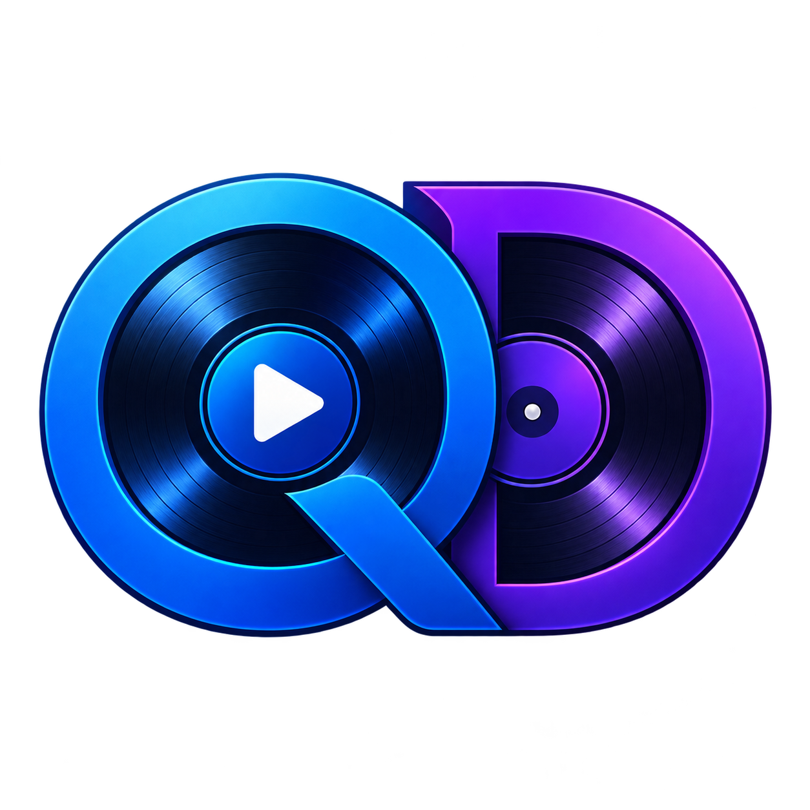

# DualQueue Player

Player de áudio nativo para macOS, desenvolvido em Swift e SwiftUI para operação ao vivo em eventos, apresentações, cultos, aulas e transmissões.

O DualQueue Player mantém duas filas independentes, um único player principal e um Sound Pad para disparos rápidos. A interface foi desenhada para leitura rápida, poucos cliques e comportamento previsível durante uma operação ao vivo.



> Status: **alpha / em desenvolvimento ativo**. O projeto já possui uma base funcional, mas ainda deve ser validado em diferentes versões do macOS e dispositivos de áudio antes de uso crítico.

## Recursos

- Duas filas independentes: Fila A e Fila B.
- Apenas uma fila principal ativa por vez.
- Troca de fila sem iniciar automaticamente a nova seleção.
- Modos de reprodução:
  - **Sequencial**: avança automaticamente até o fim da fila.
  - **Aleatório**: usa shuffle bag e histórico para evitar repetições prematuras.
  - **Manual**: para ao terminar e aguarda o operador.
- Player principal único com `AVAudioEngine` e `AVAudioPlayerNode`.
- Adição de vários arquivos por `NSOpenPanel`.
- Drag & drop de arquivos de áudio.
- Formatos iniciais: MP3, WAV, M4A, AAC e AIFF.
- Seleção, remoção e reordenação de faixas.
- Sound Pad independente em grid 4×3.
- Páginas nomeáveis de pads, renomeação e remoção com confirmação.
- Pads configuráveis com nome, ícone, volume, Overlay, Interrupt, Duck, loop, atalho opcional e opção de parar outros pads.
- Preview/Cue separado do player principal.
- Persistência automática em JSON e projetos `.dualqueue`.
- Atalhos de operação e proteção contra atalhos enquanto um campo de texto está em edição.
- Ícone do aplicativo configurado por Asset Catalog.

## Fora de escopo

O projeto não pretende ser uma DAW ou software de DJ. Não fazem parte do objetivo atual:

- BPM ou beat matching;
- pitch e time-stretch;
- VST;
- waveform complexo;
- mixagem multicanal avançada;
- edição destrutiva de áudio.

## Requisitos

- macOS 13 ou superior;
- Xcode compatível com Swift 6;
- Swift Package Manager;
- saída de áudio compatível com AVFoundation.

O uso do Xcode completo é recomendado. Apenas o Command Line Tools pode não disponibilizar todos os recursos necessários para compilar e executar a interface SwiftUI.

## Executar pelo Xcode

Abra o pacote no Xcode:

```bash
open -a Xcode Package.swift
```

Selecione o scheme `DualQueuePlayer`, escolha `My Mac` e pressione `⌘R`.

## Compilar pelo terminal

Na raiz do projeto:

```bash
swift build -c release
```

O executável será gerado dentro de `.build`.

## Gerar o aplicativo `.app`

O script cria um bundle macOS abrível pelo Finder, compila o Asset Catalog e aplica uma assinatura local ad-hoc:

```bash
bash Scripts/build-app.sh
open "dist/DualQueue Player.app"
```

O bundle final ficará em:

```text
dist/DualQueue Player.app
```

Para alterar o ícone, edite os arquivos de:

```text
Resources/Assets.xcassets/AppIcon.appiconset/
```

A logo original está em `Resources/DualQueueLogo.png`.

## Testes

Execute os testes de lógica com:

```bash
swift test
```

A suíte atual prioriza regras que não dependem de uma saída física de áudio, incluindo avanço sequencial, modo manual, shuffle bag, histórico do Previous e normalização da seleção após remoção.

## Atalhos padrão

| Tecla | Ação |
| --- | --- |
| `Space` | Play/Pause |
| `Esc` | Stop |
| `A` | Selecionar Fila A |
| `B` | Selecionar Fila B |
| `←` | Faixa anterior |
| `→` | Próxima faixa |
| `1`–`9` | Pads 1–9 |
| `0` | Pad 10 |

Os atalhos não devem interferir na digitação em campos de texto.

## Projetos e persistência

O botão **Salvar** abre um painel na primeira utilização e cria um arquivo `.dualqueue`. Depois disso, o projeto atual é atualizado automaticamente.

O autosave interno fica em:

```text
~/Library/Application Support/DualQueuePlayer/LastProject.dualqueue
```

Arquivos de áudio não são copiados para dentro do projeto. O projeto armazena os caminhos dos arquivos; se um arquivo for movido ou removido, ele é marcado como ausente sem causar crash.

## Arquitetura

```text
DualQueuePlayer/
├── App/          # ponto de entrada SwiftUI
├── Models/       # modelos Codable do projeto
├── ViewModels/   # estado e regras de interação
├── Views/        # interface SwiftUI
├── Audio/        # AVAudioEngine, pads, ducking e preview
└── Services/     # persistência e atalhos
```

Arquitetura de áudio principal:

```text
Queue A ─┐
         ├── Main Music Player ── Music Mixer ── Main Mixer ── Output
Queue B ─┘

Sound Pads ─────────────── Pad Mixer ────────────┘
```

As duas filas nunca possuem players principais separados. Elas apenas determinam qual faixa será enviada ao player único.

## Contribuindo

Pull requests e issues são bem-vindos.

Antes de abrir um pull request:

1. mantenha a lógica fora das Views;
2. preserve a regra de que apenas uma fila principal pode tocar;
3. adicione testes para novas regras de negócio;
4. execute `swift test`;
5. verifique o comportamento com teclado e drag & drop;
6. não introduza dependências externas sem necessidade clara.

Para mudanças grandes, abra uma issue descrevendo o problema, a proposta e o impacto na operação ao vivo.

## Licença

Este projeto é distribuído sob a licença MIT. Consulte o arquivo [LICENSE](LICENSE).

## Créditos

Desenvolvido com Swift, SwiftUI, AVFoundation e AVAudioEngine.
